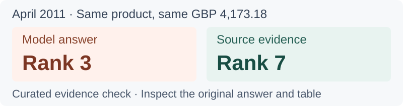

# Yuchi Wang

**Business analytics, customer workflows and AI evaluation**

I'm an M.S. student in **Business Analytics and Artificial Intelligence at Johns Hopkins Carey Business School** (expected August 2027). I graduated **cum laude from Ohio State**, with a background in accounting and logistics management.

My projects connect business analysis with AI: checking claims against source data, evaluating model limitations and developing traceable customer workflows. My experience includes consumer insights at **Ipsos**, supply chain analysis at **SF Express**, and international student onboarding as an **Ohio State Peer Advisor**.

Washington, DC · **[Resume (PDF)](assets/Yuchi_Wang_Resume.pdf)** · [LinkedIn](https://www.linkedin.com/in/yuchi-wang1202/) · [Email](mailto:yuchiwang02@outlook.com) · [Hugging Face](https://huggingface.co/Yuchiwang02)

## Selected projects

### CSM Copilot · Customer onboarding and technical handoffs

An AI-assisted prototype that separates missing onboarding evidence from failed checks, then prepares bilingual follow-ups and traceable technical handoffs. The workflow covers **five synthetic accounts, six app/platform integrations and eight MCP tools**. The browser demo replays saved outputs; it does not establish customer impact.

[Interactive demo](https://yuchi-wang02.github.io/csm-copilot/#start) · [Code and contribution statement](https://github.com/Yuchi-Wang02/csm-copilot) · [Evaluation](https://github.com/Yuchi-Wang02/csm-copilot/blob/main/evidence/EVALUATION.md)

### BizHallu · Checking AI-generated business claims

**A correct amount can still support an incorrect claim.** This workflow connects retail transactions, 100 reproducible business questions and local model answers. One inspectable case pairs the correct amount with rank 3 when the displayed evidence places the product seventh. The evaluation uses provisional, AI-assisted labels without independent human annotation.

[Inspect the ranking error](https://yuchi-wang02.github.io/bizhallu/portfolio_demo_v2.html?case=q_0064) · [Methods and results](https://yuchi-wang02.github.io/bizhallu/detector_interpretation.html) · [Code](https://github.com/Yuchi-Wang02/bizhallu)

See the example: the same amount, a different rank

### DelaySentinel · Logistics data and model evaluation

An audit of a published Llama fine-tune identifies **label leakage behind a perfect historical test score**, using simple baselines, feature ablations and behavioral probes. A separate classical-model study evaluates checkout-time information on 37,702 later Olist orders. Both studies are retrospective evaluations.

[Case study](https://github.com/Yuchi-Wang02/delaysentinel/blob/main/docs/case_study.md) · [Olist study](https://github.com/Yuchi-Wang02/delaysentinel/blob/main/docs/olist_reference.md) · [Code](https://github.com/Yuchi-Wang02/delaysentinel)

### Rebalance Lab · Financial analysis and model validation

A sector-ETF study of **trading costs, calendar sensitivity and accounting reconciliation**. Comparing six semiannual calendars and four cost scenarios shows how assumptions can change the conclusion. The repository includes saved results, paired uncertainty estimates and a dated record of my transaction-level accounting checks.

[Research site](https://yuchi-wang02.github.io/rebalance-lab/) · [Code and validation memo](https://github.com/Yuchi-Wang02/rebalance-lab) · [Personal review record](https://github.com/Yuchi-Wang02/rebalance-lab/blob/main/results/owner-review-progress.json)

**Additional research:** [Jev Scope Challenge](https://github.com/Yuchi-Wang02/jev-scope-challenge) explores evidence ownership, rule-grounded decisions and model-evaluation limitations.

## How I work

These personal projects use substantial AI assistance for implementation and review. The repositories document methods, saved evidence, personal contributions and limitations. My focus is on understanding the business question and checking what the results actually support.

*Resume updated October 15, 2026.*
